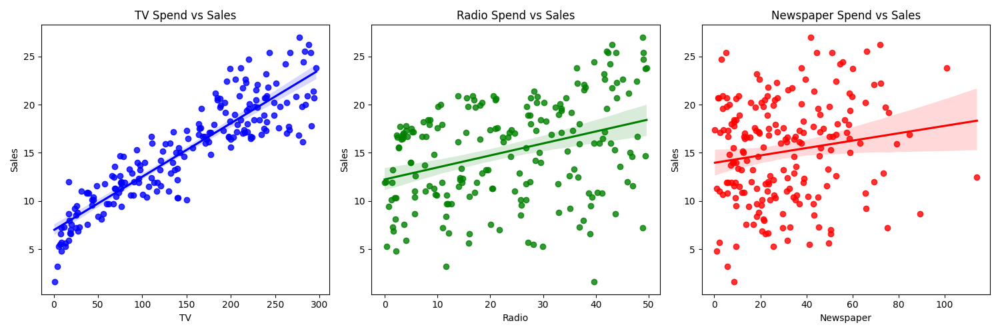
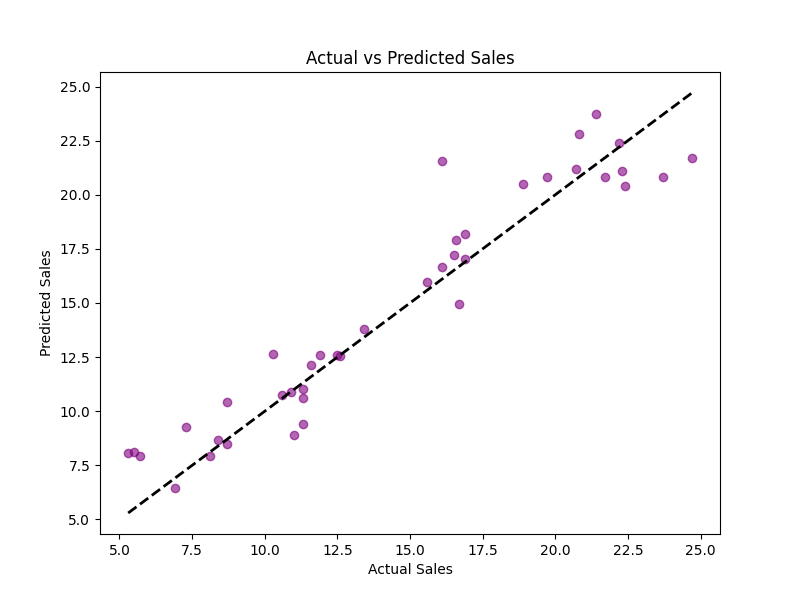

# Sales Prediction using Python

CODEVEDX Internship — Task 4

## Objective
Predict product sales based on advertising budget allocated across TV, Radio, and Newspaper.

## Dataset
`advertising.csv` — 200 rows, 4 columns (TV, Radio, Newspaper, Sales).
Budgets are in thousands of dollars; Sales are in thousands of units.
Source: Advertising dataset (ISLR), via Kaggle.

## Approach
1. Loaded and inspected the data
2. Explored the relationship between each ad channel and Sales using regression plots
3. Split data 80/20 into training and test sets
4. Trained a Linear Regression model with scikit-learn
5. Evaluated on the held-out test set
6. Built an interactive Streamlit app for live predictions

## Results (test set)
| Metric | Value |
|---|---|
Mean Absolute Error (MAE): 1.27
Mean Squared Error (MSE): 2.91
R-squared Score (R2): 0.91

## Visualizations

### Advertising Spend vs Sales


### Actual vs Predicted Sales



**Key finding:** TV and Radio spend show a strong relationship with Sales, while
Newspaper spend shows little to no clear relationship.

## Tech Stack
Python, Pandas, NumPy, Scikit-learn, Matplotlib, Seaborn, Streamlit, Joblib

## How to Run
```bash
pip install pandas numpy scikit-learn matplotlib seaborn streamlit joblib
python main.py        # trains the model and saves charts
streamlit run app.py  # launches the demo app